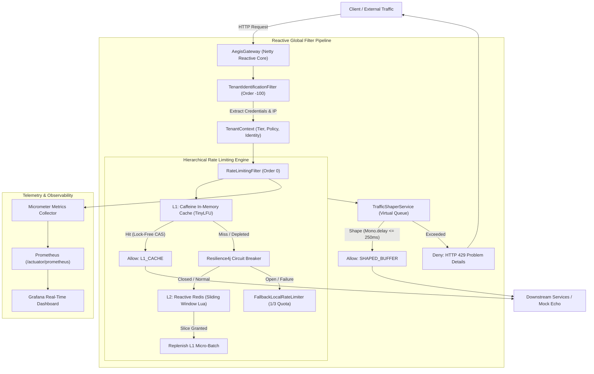

# AegisGateway

**AegisGateway** is a carrier-grade, reactive API gateway engineered in **Java 21 LTS** and **Spring Boot 3.3.4**, executing on **Spring Cloud Gateway**, **Project Reactor**, and **Netty**. It delivers sub-millisecond multi-tenant rate limiting, lock-free local token caching, distributed sliding window tracking, virtual queue traffic shaping, and circuit-breaker protected fallbacks.

---

## Architecture Overview



---

## Tenant Tier Matrix

| Tier | Sustained Quota | Burst Quota | Window Size | Traffic Shaping | Max Queue Delay | Target Identity Prefix |
| :--- | :--- | :--- | :--- | :--- | :--- | :--- |
| **FREE** | 60 req/min | 0 | 60,000 ms | Disabled | 0 ms | `key-free-*` or Client IP fallback |
| **PRO** | 1,000 req/min | 50 | 60,000 ms | Disabled | 0 ms | `key-pro-*` |
| **ENTERPRISE** | 10,000 req/min | 500 | 60,000 ms | **Enabled** | **250 ms** | `key-ent-*` |

---

## Key Features

1. **Pure Non-Blocking Reactive Architecture**:
   - Zero `jakarta.servlet` dependencies. Runs purely on Reactor Netty.
   - Java 21 Virtual Threads and Generational ZGC configuration.
2. **Two-Tier Hierarchical Rate Limiting**:
   - **L1 Cache**: In-memory Caffeine cache utilizing Window TinyLFU eviction and lock-free `AtomicLong` token leases.
   - **L2 Distributed Store**: High-performance Redis Lua script executing sliding window decay with millisecond precision and atomicity.
3. **Enterprise Traffic Shaping**:
   - Absorbs enterprise burst spikes non-blockingly using `Mono.delay()` up to 250ms SLA without dropping traffic.
4. **Resilience4j Circuit Breaker & Graceful Degradation**:
   - Protects against Redis latency spikes (>200ms) or outages.
   - Seamlessly fails open to a standalone `FallbackLocalRateLimiter` offering a conservative 1/3 quota (`LOCAL_FALLBACK_DEGRADED`) with zero HTTP 500 internal server errors.
5. **Observability & Standards**:
   - RFC 6585 rate limiting telemetry headers (`X-RateLimit-Limit`, `X-RateLimit-Remaining`, `X-RateLimit-Reset`, `X-RateLimit-Source`).
   - RFC 7807 problem details JSON for HTTP 429 rejections.
   - High-precision Micrometer metrics publishing P50, P95, and P99 decision latencies.

---

## Quick Start with Docker Compose

Launch the full stack (Gateway, Redis, Downstream Mock, Prometheus, and Grafana) with a single command:

```bash
docker compose up -d --build
```

### Services & Port Mappings

| Service | Host Port | Description |
| :--- | :--- | :--- |
| **AegisGateway** | `8080` | Reactive API Gateway entrypoint |
| **Downstream Mock** | `8081` | HTTP Echo mock server (`mendhak/http-https-echo`) |
| **Redis** | `6379` | Distributed sliding window cache with AOF persistence |
| **Prometheus** | `9090` | Metrics scraper running at 2s intervals |
| **Grafana** | `3000` | Pre-configured dashboard (`admin`/`admin`) |

### Health & Metrics Endpoints

```bash
# Gateway Health
curl -s http://localhost:8080/actuator/health

# Prometheus Metrics Scraping Endpoint
curl -s http://localhost:8080/actuator/prometheus
```

---

## Running Load Tests with k6

The included [load_test.js](file:///c:/Users/DELL/Documents/AegisGateway/load_test.js) benchmarks three concurrent traffic scenarios:
- **Enterprise Traffic**: High-throughput bursts validating virtual queue shaping and L1 micro-batch caching.
- **Pro Traffic**: High sustained traffic validating L1/L2 quota management.
- **Free-Tier Blast Traffic**: Noisy-neighbor attack executing 150 req/sec to trigger HTTP 429 rate limiting and verify noisy-neighbor isolation.

### Execution

```bash
# Ensure k6 is installed (https://k6.io/)
k6 run load_test.js
```

### Enforced Latency Thresholds

- **P95 Latency**: `< 1.5ms`
- **P99 Latency**: `< 2.5ms`

---

## Local Development & Testing

```bash
# Clean compilation
mvn clean compile

# Run complete test suite (Unit & Reactive StepVerifier tests)
mvn test

# Build executable fat JAR
mvn clean package -DskipTests
```
